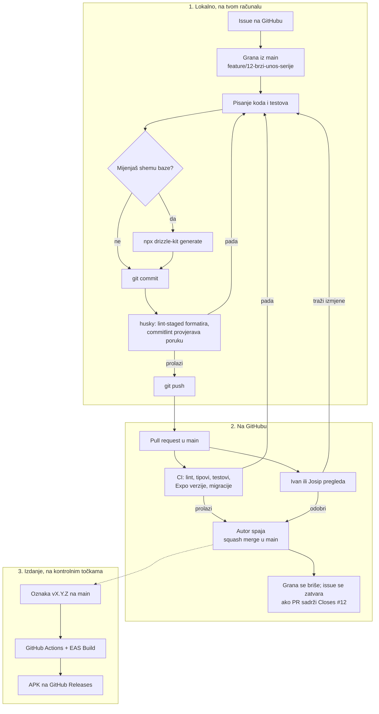

# Snagomjer

Mobilna aplikacija za bilježenje i analizu treninga snage. Seriju se unosi u nekoliko dodira, i jednom rukom između serija. Aplikacija čuva povijest treninga i grafički prikazuje napredak po vježbi. Podaci ostaju na uređaju: radi bez interneta i bez korisničkog računa.

FER timski projekt, 5 članova, 2026./2027.

> **Status:** u razvoju. Expo projekt još nije postavljen, pa naredbe iz odjeljaka Pokretanje i Razvoj rade tek nakon prvog PR-a. MVP (unos i povijest) do 18.12.2026., `v1.0.0` na primopredaji 29.1.2027.

## Funkcionalnosti

- Katalog vježbi po mišićnim skupinama, pretraga i vlastite vježbe
- Unos serija (ponavljanja × težina) s brzim unosom: kopiranje prethodne serije, tipke +/−, vrijednosti s prošlog treninga
- Prikaz prethodnog rezultata iste vježbe tijekom unosa
- Povijest treninga s uređivanjem i brisanjem
- Automatski izračun volumena (Σ ponavljanja × težina) po vježbi i po treningu
- Grafovi po vježbi kroz vrijeme: volumen, najveća težina, ukupno ponavljanja, procijenjeni 1RM (Epley)

## Tehnologije

| Alat | Namjena | Dokumentacija |
| --- | --- | --- |
| TypeScript | jezik cijelog projekta | [typescriptlang.org](https://www.typescriptlang.org/docs/) |
| React Native + Expo | jedan kod za Android i iOS; razvojni server, Expo Go i moduli Expo SDK-a | [reactnative.dev](https://reactnative.dev/docs/getting-started), [docs.expo.dev](https://docs.expo.dev/) |
| Expo Router | navigacija prema datotekama: svaka datoteka u `app/` je jedan ekran | [Expo Router](https://docs.expo.dev/router/introduction/) |
| expo-sqlite | lokalna SQLite baza na uređaju; izravno se koristi samo za otvaranje baze | [expo-sqlite](https://docs.expo.dev/versions/latest/sdk/sqlite/) |
| Drizzle ORM | shema i tipizirani upiti u TypeScriptu; `drizzle-kit` iz sheme generira migracije | [Drizzle + Expo SQLite](https://orm.drizzle.team/docs/connect-expo-sqlite) |
| react-native-gifted-charts | linijski i stupčasti grafovi napretka | [gifted-charts](https://gifted-charts.web.app/) |
| Jest | unit testovi izračuna i repozitorija | [Jest](https://jestjs.io/docs/getting-started) |
| React Native Testing Library | testovi komponenti iz perspektive korisnika | [RNTL](https://callstack.github.io/react-native-testing-library/) |
| ESLint + Prettier | provjera i formatiranje koda | [Expo: ESLint](https://docs.expo.dev/guides/using-eslint/) |
| husky, lint-staged, commitlint | pri commitu formatiraju promijenjene datoteke i provjeravaju poruku (Conventional Commits) | [husky](https://typicode.github.io/husky/), [commitlint](https://commitlint.js.org/) |
| GitHub Actions | CI na svaki PR i build izdanja | [GitHub Actions](https://docs.github.com/en/actions) |
| EAS Build | gradi Android APK na Expo serverima, pokreće se na oznaku verzije | [EAS Build](https://docs.expo.dev/build/introduction/) |

Ciljna platforma je Android (APK). iOS se testira preko Expo Go. Sučelje aplikacije je na engleskom, a dokumentacija na hrvatskom.

## Pokretanje

**Preduvjeti:** [Node.js](https://nodejs.org/) LTS, Git i aplikacija **Expo Go** na mobitelu (Google Play / App Store).

```bash
git clone https://github.com/ivanmitar35/Snagomjer.git
cd Snagomjer
npm install
npx expo start
```

QR kod iz terminala na Androidu skeniraj u Expo Go, a na iPhoneu kamerom. Mobitel i računalo moraju biti na istoj mreži. Ako nisu, pokreni `npx expo start --tunnel`.

Gotov Android APK nalazi se pod [Releases](../../releases).

## Kako doprinijeti

1. **Issue.** Svaki zadatak je issue na GitHubu. Dodijeli ga sebi ili otvori novi.
2. **Grana.** Iz ažurnog `main` napravi granu `vrsta/broj-opis`:

   ```bash
   git switch main && git pull
   git switch -c feature/12-brzi-unos-serije
   ```

   Vrste: `feature`, `fix`, `docs`, `test`, `refactor`, `chore`.
3. **Kod i testovi.** Ako mijenjaš shemu baze, pokreni `npx drizzle-kit generate` i commitaj migraciju. Prije pusha moraju proći `npm run lint`, `npx tsc --noEmit` i `npm test`.
4. **Commit.** Poruke prema Conventional Commits, na hrvatskom: `feat: brzi unos serije`, `fix: …`, `docs: …`. Pri commitu husky formatira promijenjene datoteke i provjerava poruku.
5. **Pull request u `main`.** Naslov PR-a piši u istom obliku jer postaje poruka commita na `main`. U opis stavi `Closes #12`, pa se issue zatvori sam.
6. **Pregled.** CI mora proći, a PR mora odobriti Ivan Mitar ili voditelj tima Josip Pavlić. GitHub ih obojicu sam dodaje kao reviewere (CODEOWNERS), a dovoljno je odobrenje onoga tko prvi pregleda. Ivanove PR-ove odobrava Josip, a Josipove Ivan. Ako nakon odobrenja dodaš nove commitove, javi revieweru da ih pogleda.
7. **Spajanje.** Nakon odobrenja autor spaja PR squash mergeom: svi commitovi grane postaju jedan commit na `main`. GitHub zatim sam briše granu.

**Postavke repozitorija.** Za `main` je na GitHubu postavljen ruleset: *Require a pull request before merging* s 1 obaveznim odobrenjem i *Require review from Code Owners*. Vlasnici koda u [.github/CODEOWNERS](.github/CODEOWNERS) su Ivan i Josip, pa se računa samo njihovo odobrenje. Izravan push, force push i brisanje grane `main` GitHub odbija. Iznimku (bypass) ima samo Ivan kao vlasnik repozitorija, za hitne slučajeve. Na svoje grane svatko pusha slobodno. U postavkama je dopušten samo squash merge, a grane se nakon spajanja brišu automatski. Dokumentacija se mijenja istim putem kao kod (npr. grana `docs/15-model-podataka`). U commitima i PR-ovima nema atribucije AI alata. AI agenti se drže pravila iz [AGENTS.md](AGENTS.md).

## Razvoj

### Naredbe

| Naredba | Što radi |
| --- | --- |
| `npx expo start` | razvojni server; promjene se odmah vide na mobitelu |
| `npm run lint` | ESLint + Prettier |
| `npx tsc --noEmit` | provjera tipova |
| `npm test` | Jest testovi |
| `npx drizzle-kit generate` | SQL migracija nakon promjene sheme baze |
| `npx expo install <paket>` | dodavanje paketa u verziji usklađenoj s Expo SDK-om (ne `npm install`) |
| `npx expo install --fix` | ažuriranje Expo paketa (jednom mjesečno) |

### Baza podataka

Shema je napisana u TypeScriptu (Drizzle). Nakon svake promjene sheme pokreni `npx drizzle-kit generate` i commitaj novu migraciju iz mape `drizzle/`. Aplikacija pri pokretanju sama primjenjuje migracije, pa korisnici ne gube podatke. CI javlja grešku ako migracija nedostaje.

### Izdanja

Kad se na `main` pushne oznaka verzije (`v0.1.0`, …), GitHub Actions preko EAS Builda izgradi APK i priloži ga GitHub Releaseu. Za to u GitHub Secrets treba biti `EXPO_TOKEN`.

## Struktura repozitorija

```text
app/        ekrani (Expo Router)
src/        komponente, hookovi, baza (shema, repozitoriji), izračuni
drizzle/    migracije baze, generira ih drizzle-kit
docs/       projektna dokumentacija, zadatak, slike (WBS, gantogram)
AGENTS.md   pravila za AI agente
```

Mape `app/`, `src/` i `drizzle/` nastaju s Expo projektom. Detaljna struktura je u [tehničkom planu, odj. 8](docs/tehnicki_plan.md#8-struktura-koda-i-baza-u-praksi).

## Dokumentacija

- [docs/tehnicki_plan.md](docs/tehnicki_plan.md): zahtjevi, arhitektura, model podataka, izračuni, ekrani, testiranje
- [docs/Projektna_dokumentacija_v1.1.docx](docs/Projektna_dokumentacija_v1.1.docx): službena projektna dokumentacija (FER predložak)
- [docs/zadatak.txt](docs/zadatak.txt): zadatak projekta
- [AGENTS.md](AGENTS.md): pravila za AI agente (Codex, Cursor, Copilot i drugi). Za Claude Code napravi lokalni `CLAUDE.md` s retkom `@AGENTS.md`; datoteka je u `.gitignore`.

## Flowchart


