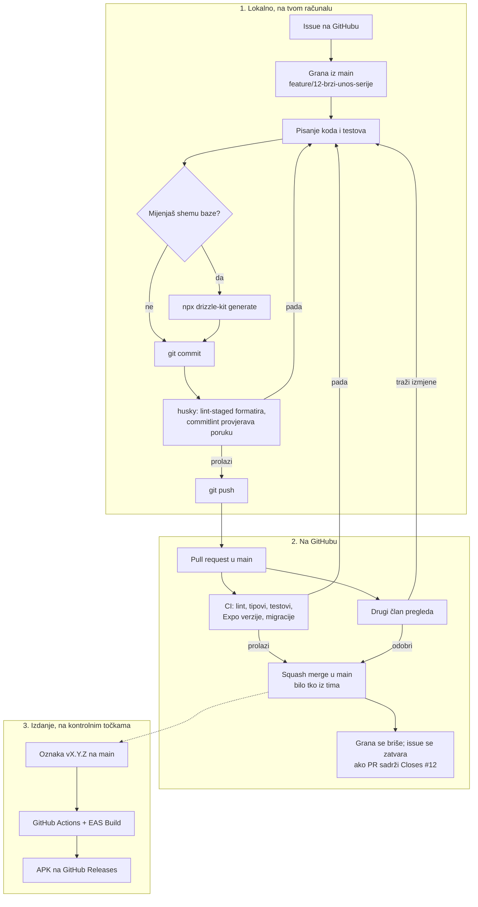

# Snagomjer

Mobilna aplikacija za bilježenje i analizu treninga snage. Seriju se unosi u nekoliko dodira, i jednom rukom između serija. Aplikacija čuva povijest treninga i grafički prikazuje napredak po vježbi. Podaci ostaju na uređaju: radi bez interneta i bez korisničkog računa.

FER timski projekt, 5 članova, 2026./2027.

> **Status:** u razvoju. MVP (unos i povijest) do 18.12.2026., `v1.0.0` na primopredaji 29.1.2027.

## Funkcionalnosti

- Katalog vježbi po mišićnim skupinama, pretraga i vlastite vježbe
- Unos serija (ponavljanja × težina) s brzim unosom: kopiranje prethodne serije, tipke +/−, vrijednosti s prošlog treninga
- Prikaz prethodnog rezultata iste vježbe tijekom unosa
- Povijest treninga s uređivanjem i brisanjem
- Automatski izračun volumena (Σ ponavljanja × težina) po vježbi i po treningu
- Grafovi po vježbi kroz vrijeme: volumen, najveća težina, ukupno ponavljanja, procijenjeni 1RM (Epley)

## Tehnologije

| Alat | Namjena | Dokumentacija |
| --- | --- | --- |
| TypeScript | jezik cijelog projekta | [typescriptlang.org](https://www.typescriptlang.org/docs/) |
| React Native + Expo | jedan kod za Android i iOS; razvojni server, Expo Go i moduli Expo SDK-a | [reactnative.dev](https://reactnative.dev/docs/getting-started), [docs.expo.dev](https://docs.expo.dev/) |
| Expo Router | navigacija prema datotekama: svaka datoteka u `app/` je jedan ekran | [Expo Router](https://docs.expo.dev/router/introduction/) |
| expo-sqlite | lokalna SQLite baza na uređaju; izravno se koristi samo za otvaranje baze | [expo-sqlite](https://docs.expo.dev/versions/latest/sdk/sqlite/) |
| Drizzle ORM | shema i tipizirani upiti u TypeScriptu; `drizzle-kit` iz sheme generira migracije | [Drizzle + Expo SQLite](https://orm.drizzle.team/docs/connect-expo-sqlite) |
| react-native-gifted-charts | linijski i stupčasti grafovi napretka | [gifted-charts](https://gifted-charts.web.app/) |
| Jest | unit testovi izračuna i repozitorija | [Jest](https://jestjs.io/docs/getting-started) |
| React Native Testing Library | testovi komponenti iz perspektive korisnika | [RNTL](https://callstack.github.io/react-native-testing-library/) |
| ESLint + Prettier | provjera i formatiranje koda | [Expo: ESLint](https://docs.expo.dev/guides/using-eslint/) |
| husky, lint-staged, commitlint | pri commitu formatiraju promijenjene datoteke i provjeravaju poruku (Conventional Commits) | [husky](https://typicode.github.io/husky/), [commitlint](https://commitlint.js.org/) |
| GitHub Actions | CI na svaki PR i build izdanja | [GitHub Actions](https://docs.github.com/en/actions) |
| EAS Build | gradi Android APK na Expo serverima, pokreće se na oznaku verzije | [EAS Build](https://docs.expo.dev/build/introduction/) |

Ciljna platforma je Android (APK). iOS se testira preko Expo Go.

## Pokretanje

**Preduvjeti:** [Node.js](https://nodejs.org/) LTS, Git i aplikacija **Expo Go** na mobitelu (Google Play / App Store).

```bash
git clone <adresa-repozitorija>
cd snagomjer
npm install
npx expo start
```

QR kod iz terminala na Androidu skeniraj u Expo Go, a na iPhoneu kamerom. Mobitel i računalo moraju biti na istoj mreži. Ako nisu, pokreni `npx expo start --tunnel`.

Gotov Android APK nalazi se pod [Releases](../../releases).

## Razvoj

### Naredbe

| Naredba | Što radi |
| --- | --- |
| `npx expo start` | razvojni server; promjene se odmah vide na mobitelu |
| `npm run lint` | ESLint + Prettier |
| `npx tsc --noEmit` | provjera tipova |
| `npm test` | Jest testovi |
| `npx drizzle-kit generate` | SQL migracija nakon promjene sheme baze |
| `npx expo install <paket>` | dodavanje paketa u verziji usklađenoj s Expo SDK-om (ne `npm install`) |
| `npx expo install --fix` | ažuriranje Expo paketa (jednom mjesečno) |

### Način rada

1. Svaki zadatak je issue na GitHubu. Iz `main` se radi kratka grana `vrsta/broj-opis`, npr. `feature/12-brzi-unos-serije`.
2. Commit poruke pišu se prema Conventional Commits, na hrvatskom: `feat: brzi unos serije`, `fix: …`, `docs: …`. Pri commitu husky + lint-staged formatiraju promijenjene datoteke, a commitlint provjerava poruku.
3. Za spajanje u `main` otvara se pull request. CI mora proći (lint, tipovi, testovi, verzije Expo paketa, migracije), a PR odobri jedan drugi član tima. Nakon toga PR može spojiti bilo tko iz tima, pa i sam autor.
4. Spaja se squash mergeom, a grana se nakon toga briše.

Na `main` se ne pusha izravno. Dokumentacija nema posebnu granu: i ona je na `main`, a mijenja se isto kao kod, kroz kratku granu (npr. `docs/15-model-podataka`) i PR.

### Baza podataka

Shema je napisana u TypeScriptu (Drizzle). Nakon svake promjene sheme pokreni `npx drizzle-kit generate` i commitaj novu migraciju iz mape `drizzle/`. Aplikacija pri pokretanju sama primjenjuje migracije, pa korisnici ne gube podatke. CI javlja grešku ako migracija nedostaje.

### Izdanja

Kad se na `main` pushne oznaka verzije (`v0.1.0`, …), GitHub Actions preko EAS Builda izgradi APK i priloži ga GitHub Releaseu. Za to u GitHub Secrets treba biti `EXPO_TOKEN`.

## Struktura repozitorija

```text
app/       ekrani (Expo Router)
drizzle/   migracije baze, generira ih drizzle-kit
docs/      projektna dokumentacija, zadatak, slike (WBS, gantogram)
```

## Dokumentacija

- [docs/tehnicki_plan.md](docs/tehnicki_plan.md): zahtjevi, arhitektura, model podataka, izračuni, ekrani, testiranje
- [docs/Projektna_dokumentacija_v1.1.docx](docs/Projektna_dokumentacija_v1.1.docx): službena projektna dokumentacija (FER predložak)
- [docs/zadatak.txt](docs/zadatak.txt): zadatak projekta

## Flowchart


